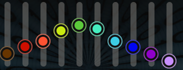

# WN 1.4

Offline Android noise mixer with saved spectral profiles, microphone/file profiling, and a desktop Python profiler. Android 8+ (API 26); target API 35. No account or network permission.

## Downloads

- [Install WN 1.4.0 APK](https://github.com/96-6/wn/raw/refs/heads/main/apk/WN-1.4.0.apk)
- [Built-in Adjusted profile JSON](presets/adjusted.json)
- [PC profiler](tools/profile_audio.py)
- [JSON example](presets/adjusted-example.json)

The installer is a signed development APK. **1.4 updates 1.1–1.3 in place**, preserving profiles, generator levels and stereo settings. For version 1.0, export its adjusted JSON first, uninstall the old app, then install 1.4 and import that JSON. The 1.0 signing key was unavailable, so it cannot update in place. Clearing/uninstalling an app removes its private data.

## Adjusted generator types

Adjusted is derived from the entire supplied 32.997-second recording. Its 23 adjoining gain regions cover **80–6,780 Hz**, containing **99.89%** of measured mean spectral energy, with a 150 Hz or 4% frequency margin. Quiet selected regions retain at least 22% linear gain. This deliberately covers more bandwidth than the ordinary sparse profiling modes.

The Adjusted card has **Type**:

- **Continuous noise:** independently generated, steady noise shaped by the measured spectrum.
- **Oscillating noise + tone:** the same shaped noise bed plus two slightly detuned harmonic banks. A 335-parameter stochastic neural network learns pitch/energy transitions from the 413 measured control points. At playback it draws fresh random control events and durations; it never walks through or wraps the recording's timeline. Each playback session uses a fresh seed. Older motion profiles without a trained network use conditional random resampling. No speech waveform is replayed.

**Voice masker** is the third type in 1.4. It has a recommended Noise-first preset and an optional Speech-like blend with moving vocal-tract resonances, voiced harmonics and breathy consonant noise. See the comparison below.

Adjusted is added as the second generator on first install or first upgrade to 1.2. Its type defaults to Continuous noise. To hear both types together, add another generator using Adjusted and set its Type to Oscillating noise + tone; levels remain independent. You can remove either extra generator and return to Default alone. A removed generator is not recreated on restart, and its saved profile remains available. If an existing scene already has eight generators, Adjusted is saved in Profiles without replacing a layer. A full 128-profile catalogue is left intact; free a profile slot and restart to install Adjusted.

The JSON includes both spectral bands and optional low-rate `motion` controls, so export/import retains both types. Existing version-1 JSON without `motion` remains compatible and uses continuous noise. Type choices and fine controls belong to each generator and persist separately from the profile. The optional `motion.model` object stores validated `mdn1` network weights and normalization. Use WN 1.3+ for the procedural neural playback.

See [measured analysis](docs/adjusted-analysis.json) and [spectrum/contours](docs/adjusted-spectrum.png). Only derived profile data is included; the source recording is not published. These are spectral maskers. Actual speech masking depends on playback level, speaker, room and listener position; neither type performs phase cancellation or identifies a particular person.

To reproduce this reference analysis on a PC:

~~~sh
python tools/build_adjusted_profile.py recording.flac -o adjusted.json --report analysis.json
~~~

This companion uses the same NumPy/FFmpeg dependencies as the main profiler. It defaults to the first 120 seconds; `--duration 0` reads the whole file. Input channel powers are averaged without phase cancellation; pitch follows the strongest channel. Motion supports at most 2,048 control points (about 164 seconds at this tool's 80 ms step).

## Voice masker: measured recommendation

Select **Adjusted → Type → Voice masker → Fine controls & preview**.

- **Noise-first** uses a gentle spectral rebalance selected for the supplied voice recording. It keeps continuous coverage and is the recommended default.
- **Speech-like blend** adds independently generated pseudo-voices. Their changing vowel resonances and voiced/unvoiced sounds use a 24-state LPC envelope codebook, randomized transitions and the existing neural pitch/energy model. No phrase or source timeline loops.
- **Voice level**, **Noise level**, **Voice oscillation speed**, **Variation**, **Pitch shift**, **Voice spread**, and **Voices (1–4)** are adjustable. Voice settings are saved separately from the older oscillating settings. Noise-first/Speech-like blend buttons change only the voice/noise balance; Reset voice settings restores all voice defaults.
- The preview's **generator type selector** switches between all available types while keeping the same reference file/session running. Fine controls are hidden for Continuous noise. The source still plays once, and its level remains fixed after calibration until Rebalance is pressed.

Noise-first defaults to voice level 0% and noise level 100%. The light Speech-like blend starts around voice level 34.4% and noise level 97.5%, using the same gain reference as the existing oscillator; all other controls remain at their neutral defaults and voice count is four. Raise voice level or lower noise level for a stronger vocal texture. A more voice-like sound is not automatically a stronger speech masker.

In **1,290 scored mixtures**, the new Noise-first and light Speech-like variants had lower final-test STOI/ESTOI than either existing mode, with both full-band RMS matching and LUFS matching. Noise-first had the lowest primary validation/final-test ESTOI; the light blend was close. This is a comparison within one supplied recording, not a human intelligibility trial or proof of room-level cancellation.

[Detailed protocol and results](docs/VOICE_MASKER_COMPARISON.md) · [summary JSON](docs/voice-comparison.json) · [all trial scores](docs/voice-comparison-trials.csv)

Generated-only listening examples (ten seconds each, approximately −23 LUFS; no reference speech mixed in): [Noise-first](docs/audio/voice-noise-first.mp3), [Speech-like blend](docs/audio/voice-speech-like.mp3), [vocal component alone](docs/audio/voice-voices-only.mp3). Quantitative scores use uncompressed Java output, not these MP3s.

The shipped Adjusted profile contains the trained voice model. PC/Colab training from an audio file now creates one too. On-device sparse profiling still produces ordinary spectral-noise profiles; import a voice-trained JSON to obtain this type for another recording. The supplied defaults were selected for the supplied recording; other recordings may need their own comparison.

## Oscillating controls and preview

Select **Oscillating noise + tone → Fine controls & preview**. Values apply live and are saved per generator.

| Control | Range | Default |
|---|---:|---:|
| Tone level | 0–200% of the previous tone balance | 100% |
| Noise level | 0–200% of the previous noise balance | 100% |
| Voice oscillation speed | 25–400% | 100% |
| Variation | 0–200% | 100% |
| Pitch shift | −12 to +12 semitones, 0.1 steps | 0 |
| Tone spread | 0–200% of the previous detuning | 100% |

Reset oscillating settings restores these six values. It leaves generator level, enabled state, selected type, profile, Master and stereo width intact. Existing 1.2 settings retain their previous tone/noise ratio, detuning and nominal speed while receiving non-looping procedural motion. The saved built-in profile gains the trained model without changing its name or spectral bands. Deleted profiles/generators stay deleted.

**Jamming preview:** choose a mono/stereo audio file, offset and 1–60-second duration. Source only, Masker only and Mixed share the same AudioTrack and audio-focus/Stop path. All enabled generators participate, and fine controls stay live. The source plays once, never on repeat. Preview audio is decoded into bounded memory (at most 60 seconds of 48 kHz stereo), not copied to persistent storage. File support follows Android's installed codecs; surround preview requires a mono/stereo conversion.

The balance slider spans −12 to +24 dB, default **+6 dB**, roughly **2× masker/source RMS amplitude**. This is a digital comparison using the clip's RMS and an initial one-second calibration of the generator mix. The source reference then stays fixed, so fine gain changes remain audible; Rebalance explicitly recalibrates it. It does not measure speech intelligibility in a real room. Peak limiting can reduce the combined level. The preview uses linear resampling when necessary. Ending/leaving preview restores whether ordinary playback was running beforehand; notification Stop stops the whole output. Preview balance/monitor choices are remembered and have a separate Reset.

## Train another profile locally or in Colab

The pitch/energy network was trained locally on CPU in about one second. Audio inputs also fit a compact LPC vocal-envelope codebook and transition model. It models random control movement, not speech synthesis or speaker identity. Android runs its small network in Java without a machine-learning runtime or network permission. Training loss measures fit to the provided controls and does not measure masking effectiveness.

~~~sh
python tools/train_motion_model.py voice.flac -o adjusted-trained.json --device cpu --epochs 1800
# A pre-profiled JSON with motion data can also be trained.
python tools/train_motion_model.py existing.json -o trained.json --device auto --epochs 3000
~~~

NumPy training uses the existing profiler requirements. `--device auto` uses PyTorch/CUDA when available, otherwise NumPy/CPU. `--device cuda` requires a CUDA-capable PyTorch installation. Vocal-envelope fitting uses NumPy on CPU and needs no GPU. Output files are protected unless `--force` is given. Import the result in Profiles, add a generator and choose Voice masker (WN 1.4+) or Oscillating noise + tone. Audio inputs train the vocal envelopes; an existing JSON retains its voice model when present.

[Open training notebook in Colab](https://colab.research.google.com/github/96-6/wn/blob/main/tools/Train_WN_Motion.ipynb) · [copyable Colab command block](tools/COLAB.md) · [local training report](docs/motion-training.json). In Colab select Runtime → Change runtime type → T4 GPU to use CUDA. The notebook uses your chosen file in your own Colab runtime.

## Android

**Mixer:** Default is always present. Adjusted starts alongside it. Add up to seven additional generators (eight total), choose a saved profile for each, and set each generator's level and enabled state independently. Remove any additional generator to return to Default alone. Removing a generator never deletes its profile. Master controls the final mix; stereo width is Mono, Narrow, Default or Wide. Android chooses the media output route.

**Profiles:** Import JSON, create a profile from microphone/audio, rename, export, or delete unused profiles. Up to 128 profiles are stored privately on the device and committed to disk before the app reports success. Repeated imports create new saved profiles rather than overwriting existing ones.

**Microphone:** Choose a name, duration (1–120 seconds) and Narrow/Balanced/Broad selection. Recording requests microphone permission only when needed, stops WN playback, and ends if the screen leaves the foreground. Finish recording early with the button. No raw microphone recording is retained. The generated profile saves automatically; then add a generator or export JSON.

**Audio file:** Choose a local audio file or video containing audio. Start offset and duration select a segment; the first supported audio track is analyzed. Playback may continue during file analysis. Decoding uses Android's installed codecs: commonly WAV/PCM, MP3, AAC/M4A, FLAC, Ogg/Vorbis, Opus and AMR, depending on the device. For unsupported formats, use the PC tool and import its JSON.

**Background playback:** A media foreground service owns audio synthesis, notification/media controls, audio focus and the CPU wake lock. Closing the mixer does not stop it. Stop releases audio resources and the wake lock. Transient focus interruptions pause/duck playback; permanent loss stops it. If a manufacturer restricts it, use Battery settings → Unrestricted. Force-stop, reboot and device-specific battery policies can stop any ordinary app; playback does not auto-start at boot.

## PC profiler

Python 3.10+ and NumPy. FFmpeg is found on PATH, supplied with --ffmpeg, or obtained from the optional imageio-ffmpeg wheel.

~~~sh
python -m pip install -r tools/requirements-profiler.txt
python tools/profile_audio.py --gui
~~~

No arguments also opens the small Tkinter GUI. Windows/macOS Python installers commonly provide Tk; Linux may need the distribution's python3-tk package. The GUI has file selection, microphone capture, profile naming, selection modes, JSON output and diagnostic reports.

~~~sh
# Profile a file. No extension whitelist; FFmpeg detects its actual container/codec.
python tools/profile_audio.py voice.m4a -o voice.json --name "Voice" --diagnostics debug

# Analyze the whole file, or a segment.
python tools/profile_audio.py voice.flac -o full.json --duration 0
python tools/profile_audio.py video.mkv -o segment.json --start 12 --duration 30 --stream 0

# Headerless raw PCM needs its missing format information.
python tools/profile_audio.py capture.raw -o raw.json --raw-format s24le --raw-sample-rate 48000 --raw-channels 2

# Inspect/normalize an existing profile.
python tools/profile_audio.py --import-json voice.json --print
python tools/profile_audio.py --import-json voice.json -o copy.json

# Show what this FFmpeg build actually supports.
python tools/profile_audio.py --formats
~~~

For microphone input:

~~~sh
python -m pip install -r tools/requirements-microphone.txt
python tools/profile_audio.py --list-devices
python tools/profile_audio.py --mic --duration 15 --device 0 -o microphone.json
~~~

Sounddevice/PortAudio is optional and used only for microphone capture. Linux may need libportaudio2. Ctrl+C finishes a CLI microphone capture early. GUI Cancel discards the unfinished analysis.

Modes match Android. Advanced CLI parameters are --coverage, --occupancy and --max-bands. Diagnostic output includes analysis.json, spectrum.csv and spectrum.svg. Existing JSON outputs are protected unless --force is given or replacement is confirmed in the GUI.

File support follows the **actual FFmpeg build's** demuxers/decoders, including audio tracks inside video containers. It is not limited to WAV/MP3; tests include FLAC, AAC/M4A, Ogg, Opus, WMA, AIFF, CAF, float/24-bit WAV, extensionless files and raw PCM. Encrypted/DRM-protected data and formats missing from that FFmpeg build cannot be decoded. Source audio is processed locally.

## Portable profile JSON

The spectral schema remains compatible with version 1.0. Version 1.4 also preserves optional `motion: {stepMs, pitchHz: [...], energy: [...]}`: 2–2,048 matching control points, 20–1,000 ms per point, pitch 60–1,000 Hz and energy 0–1. Versions before 1.2 can read its spectral bands but do not offer oscillating playback.

~~~json
{
  "version": 1,
  "name": "Voice",
  "bands": [
    {"lowHz": 180, "highHz": 340, "level": 0.65},
    {"lowHz": 650, "highHz": 1100, "gainDb": -3},
    {"lowHz": 1800, "highHz": 2900, "level": 1}
  ]
}
~~~

Use 1–64 sorted non-overlapping bands within 20–22000 Hz, each at least 20 Hz wide. Each band uses level (linear amplitude, 0–1) or gainDb (-60–0), not both. Names have 1–80 readable characters; UTF-8 files may have a BOM. File size limit: 256 KiB. At least one level must be nonzero.

Voice-trained profiles can additionally carry a `voice` object (version 1): 24 increasing `centersHz`, 4–32 spectral `states` with pitch/energy/voicing and 24 positive gains, a matching transition matrix and stationary weights, plus `mix`, `speechMix`, and `tilt` defaults. Matrices, finite values and bounds are validated before playback. Voice data requires motion data. Older apps may discard the extra voice metadata when re-exporting.

A ten-band profile can use levels instead of bands, at 31.5, 63, 125, 250, 500, 1000, 2000, 4000, 8000 and 16000 Hz:

~~~json
{"version":1,"name":"Flat","levels":[1,1,1,1,1,1,1,1,1,1]}
~~~

The fixed Default curve approximates the unlabeled reference image: levels .17, .29, .38, .56, .65, .59, .38, .28, .16, .04. It is shaped white noise, not an exact reconstruction of unknown original frequency labels/amplitude units.

## Profiling method

Both tools use 4096-sample Hann windows with 50% overlap; spectra from individual channels are averaged as **power**, so opposite-phase stereo does not cancel. An RMS histogram rejects frames below -60 dBFS or 25 dB below the strongest frame. In the 80–8000 Hz range (limited by source Nyquist), power is grouped into 40-Hz bins, smoothed and ranked. Sparse ranges are selected up to the occupancy cap, then limited by the band-count cap.

| Mode | Requested energy | Maximum in-range occupancy | Maximum bands |
|---|---:|---:|---:|
| Narrow | 65% | 20% | 12 |
| Balanced | 80% | 35% | 16 |
| Broad | 90% | 50% | 24 |

Reported energy retention is measured in the analyzed frequency range. A diffuse recording may not reach the requested energy within the bandwidth cap. Exported gains follow the measured relative spectral density. This is static spectral masking, not speaker identification or selective voice cancellation; voices and other sounds can share the same frequencies. Use a clean sample of the desired speech.

## Development

JDK 17, Gradle 8.11.1 wrapper, Android SDK Platform 35/build-tools 35.0.0:

~~~sh
./gradlew testDebugUnitTest lintDebug assembleDebug assembleDebugAndroidTest
./gradlew connectedDebugAndroidTest
python -m unittest discover -s tools/tests -v
~~~

The checked-in APK is the locally signed deliverable; CI artifacts are separate development builds and may use a different debug certificate. Never publish a signing keystore. Supply your own private release key for a public production release.

GitHub Actions runs JVM/PC checks and Android device tests using an emulator with hardware acceleration. Microphone acoustics still require a real-device test. See [validation](docs/VALIDATION.md).
